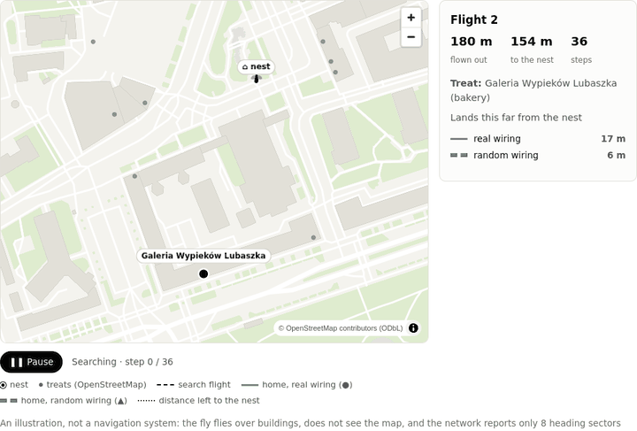
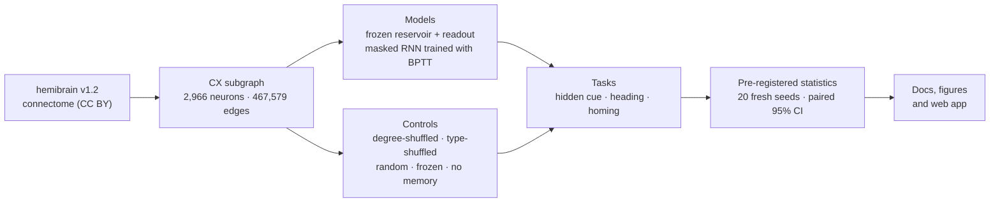
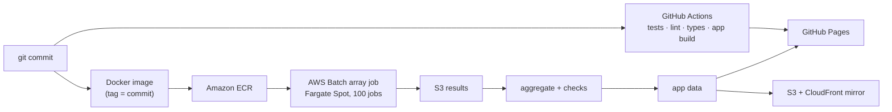
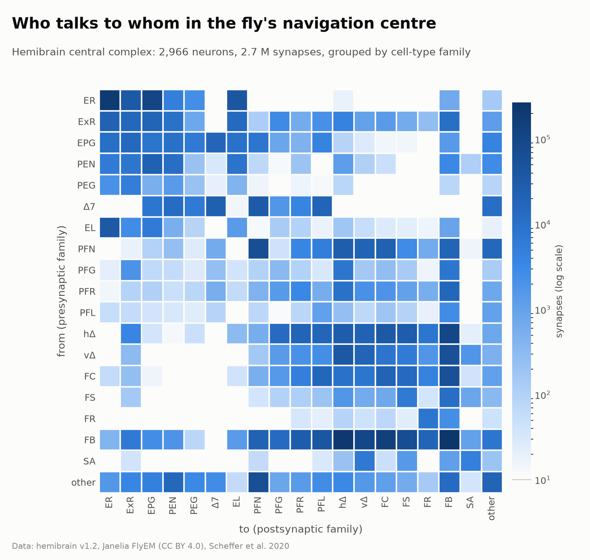
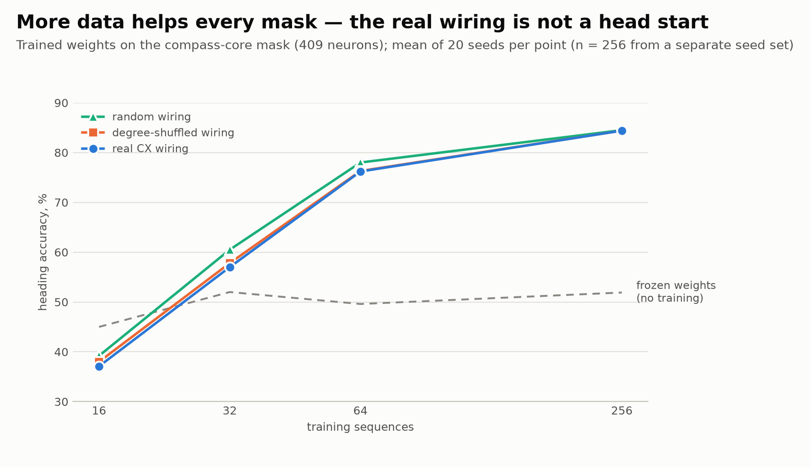

# NeuroFlyNav

[](https://github.com/kat1478/NeuroFlyNav/actions/workflows/quality.yml)


**Does the wiring of a fly's navigation centre make a better brain for an artificial agent?**

NeuroFlyNav takes the real connectome of the *Drosophila* central complex (CX) — the brain
region flies use to keep track of heading and steer — and uses it as the fixed recurrent core
of a navigation agent. It then compares that agent against fair controls: the same wiring
shuffled, a random network of the same size, and a network with no memory at all. Biological
topology is a hypothesis to test, not an assumption; a negative result is a valid outcome.

**▶ Live app: [kat1478.github.io/NeuroFlyNav](https://kat1478.github.io/NeuroFlyNav/)** — every
pre-registered comparison seed by seed, the central-complex wiring with a glossary of its cell
types, a step-by-step replay of a network keeping track of heading, and a fly foraging over central
Warsaw (OpenStreetMap) that flies home by path integration.



> **Status: v0.7.0, exploratory.** The pipeline runs end to end on the real CX wiring (2,966
> neurons, 467,579 connections), locally or as containerised sweeps on AWS Batch. Model choices
> (dynamics, inputs, readout) are still exploratory: each comparison's decision rule was fixed
> before it ran (pre-registered), but no overall protocol is frozen yet. Read the numbers below
> as leads, not settled scientific claims.

## What this project demonstrates

| Area | What | Where |
| --- | --- | --- |
| Research design | Hypotheses with fair controls, decision rules fixed before each run, fresh seeds, paired 95% CIs, negative results reported as such | [docs/](docs/), results below |
| Machine learning | Reservoir computing; recurrent networks whose weights live only on connectome edges, trained with backpropagation through time (PyTorch) | [`training/`](src/neuroflynav/training/), [`agent/`](src/neuroflynav/agent/) |
| Data engineering | Public connectome export → typed graph with checksums; OpenStreetMap extract → vector tiles of Warsaw | [`graph/hemibrain.py`](src/neuroflynav/graph/hemibrain.py), [`geo/`](geo/) |
| Software engineering | Typed Python (mypy strict), 81 + 13 automated tests, ruff, CI on every pull request, semantic-versioned releases | [`tests/`](tests/), [CI](.github/workflows/quality.yml), [CHANGELOG](CHANGELOG.md) |
| Cloud / MLOps | Docker image in ECR, 100-job sweeps on AWS Batch (Fargate Spot), S3, least-privilege IAM, budget alerts, all in Terraform | [`infra/`](infra/README.md), [docs/cloud.md](docs/cloud.md) |
| Frontend / data visualisation | Vite + TypeScript, Observable Plot, MapLibre with self-hosted PMTiles, light/dark, WCAG AA contrast and ARIA, fixes from independent UI/UX audits; GitHub Pages + CloudFront | [`app/`](app/), [docs/app.md](docs/app.md) |

## How it works

**Question.** Does the real wiring help, compared with the same network rewired (keeping each
neuron's number of connections), rewired only within cell types, or wired at random with the
same number of connections? And if it helps, is it the exact neuron-to-neuron map or only which
cell types connect?





1. **Graph** — every neuron with at least one synapse in the six CX regions (AB left and right,
   EB, FB, NO, PB), and every directed connection between them (`neuroflynav.graph.hemibrain`).
2. **Models** — a fixed *reservoir* (the wiring as a frozen weight matrix, observations entering at
   the ring neurons, only a linear readout learned; `neuroflynav.agent.reservoir`) and a *masked
   RNN* in which every connectome edge carries a weight learned by backpropagation through time,
   and missing edges stay zero (`neuroflynav.training.masked_rnn`).
3. **Tasks** — remember a briefly shown goal in a grid world (`neuroflynav.env.nav_memory`); keep
   track of heading from self-motion between landmarks (`neuroflynav.tasks.heading`); fly home from
   a foraging trip by adding up the heading estimates (`neuroflynav.tasks.homing`).
4. **Controls** — `ShuffledFly` (degree-preserving rewiring), `TypeShuffledFly` (rewiring within
   cell types), `RandomRecurrent` / `RandomMask` (random wiring with the same number of edges, for
   the reservoir and the trained network respectively), `FrozenFly` (real wiring, recurrent
   weights not trained), `Reactive` (no memory).
5. **Statistics** — every variant sees the same data and budget; differences are paired within
   each seed over 20 fresh seeds, with 95% confidence intervals.

## Results at a glance

<picture>
  <source media="(prefers-color-scheme: dark)" srcset="docs/figures/cx-wiring-dark.png">
  
</picture>

<picture>
  <source media="(prefers-color-scheme: dark)" srcset="docs/figures/results-forest-dark.png">
  
</picture>

<picture>
  <source media="(prefers-color-scheme: dark)" srcset="docs/figures/heading-progression-dark.png">
  
</picture>

<picture>
  <source media="(prefers-color-scheme: dark)" srcset="docs/figures/learning-curve-dark.png">
  
</picture>

Numbers behind every chart: the tables in `docs/spike_*.md`. Rebuild the figures with
`PYTHONPATH=src python -m neuroflynav.reporting.figures`.

## First look (20 seeds)

Success rate on the hidden-cue task, mean and 95% CI, `log1p` edge weights:

| Agent | Success rate |
| --- | --- |
| FlyConnectome (real CX wiring) | 0.64 [0.59, 0.68] |
| ShuffledFly (same degrees, rewired) | 0.56 [0.53, 0.60] |
| RandomRecurrent (same size) | 0.57 [0.53, 0.61] |
| Reactive (no memory) | 0.31 [0.30, 0.32] |

Paired difference FlyConnectome − ShuffledFly: **+0.08 [+0.02, +0.13]** — a small edge for the
real wiring. A pre-registered follow-up on fresh seeds 20–39 **replicated** it (+0.06
[+0.02, +0.11]) and showed where it comes from: a control that keeps the cell-type-to-cell-type
wiring but shuffles exact partners performs as well as the real graph (−0.01 [−0.05, +0.02]).
On this task the benefit is in *which cell types connect*, not in the exact neuron map. With
wiring-only (`binary`) weights there is no edge. All of this is exploratory: toy task,
placeholder dynamics. Full tables: [docs/spike_m1.md](docs/spike_m1.md).

A second, pre-registered task — keeping track of heading from self-motion between landmarks —
gives the same picture: real wiring +0.03 over the degree-preserving shuffle, cell-type
structure enough, and no reservoir yet integrates (all stay below a memory-only reference).
Adding biologically placed inhibition (Δ7 and ring neurons) to the generic reservoir made it
*worse* — a sign that the dynamics, not the wiring or the signs, are now the bottleneck.
With *leaky* (slower) dynamics the reservoir finally integrates self-motion, beating a perfect
memory of the last landmark by +0.07 — but so does every control, and the real wiring keeps only a
~1-point edge. Integration comes from the dynamics; cell-type structure explains the rest.
See [docs/spike_heading.md](docs/spike_heading.md).

Training the recurrent weights on the compass-core mask (409 neurons) makes a much better
integrator (0.84 vs 0.52 frozen) — but a random mask of the same density trains just as well,
and with scarce data even slightly better (−2.4 points for the real mask, pre-registered).
The compass core is dense (26% of all possible connections). On the **whole CX** (5.3%), run as
100 cloud jobs, the picture changes: the real wiring trains better than a random mask of the
same size (**+2.8 points [+2.1, +3.6]**, the pre-registered test) and than a degree-preserving
shuffle (+3.7). The real wiring is only +1.1 ahead of a within-cell-type shuffle, so cell-type
structure carries most of the advantage. One task, one model, one training budget — a lead, not a
conclusion. See [docs/spike_trained.md](docs/spike_trained.md).

Does that heading edge help a fly **get home**? A follow-up flies the same trained networks on
foraging trips through the real café and bakery layout of central Warsaw and sums their heading
estimates into a home vector. Pre-registered on fresh seeds: the real wiring lands 1.2 m closer to
the nest than a random wiring of the same size, but the interval includes zero (−1.2 m [−4.1, +1.7])
— **no homing advantage**. Training matters far more (with frozen recurrent weights the fly lands 166 m away).
See [docs/spike_homing.md](docs/spike_homing.md).

## Cloud runs

The whole-CX sweep (5 variants × 20 seeds) would take ~30 h on a laptop. It runs on AWS as a
Batch array job, one container per (variant, seed):

```
git commit ──► Docker image ──► Amazon ECR ──► AWS Batch array job ──► S3 results ──► aggregate
 (code)        micromamba,       private       Fargate Spot, 4 vCPU       one JSON     same summary
               same conda env    registry      / 8 GB per job, ≤3 at once  per job      as local runs
```

- **Infrastructure as code** — Terraform in [infra/](infra/README.md): ECR, a private encrypted
  S3 bucket, least-privilege IAM roles (jobs can only write results), Batch on Fargate Spot,
  CloudWatch logs and a cost budget with alerts.
- **Reproducible** — the image is tagged with the git commit; the container downloads the
  public connectome and checks its SHA-256; a pilot job matched the local result exactly.
- **Measured** — 100/100 jobs succeeded, 7.8 job-hours in 3.3 h wall time; the day of the run
  (sweep plus pilot) cost 0.63 USD in AWS Cost Explorer; idle cost is near zero because Fargate
  scales to zero.

How to run it: [docs/cloud.md](docs/cloud.md).

## Quick start

```bash
mamba env create -f environment.yml
conda activate neuroflynav
make quality                                   # pytest, ruff format/lint, mypy

# synthetic graph, no download needed
PYTHONPATH=src python -m neuroflynav.experiments.run_m0plus --seed 0

# real CX wiring: download the public export first (46 MB, see docs/spike_m1.md)
PYTHONPATH=src python -m neuroflynav.experiments.run_m0plus --graph hemibrain --weights log1p
PYTHONPATH=src python -m neuroflynav.experiments.run_m1_seeds --seeds 20
```

Dependencies are managed with Conda only (`environment.yml`, conda-forge). The `src/` layout is
importable without installation; one hemibrain seed takes about 30 s on a laptop CPU.

## Documentation

| Doc | What it covers |
| --- | --- |
| [docs/spike.md](docs/spike.md) | M0: first end-to-end loop on a synthetic graph |
| [docs/spike_m0plus.md](docs/spike_m0plus.md) | M0+: hidden-cue task and reservoir, so topologies can be told apart |
| [docs/spike_m1.md](docs/spike_m1.md) | M1: real hemibrain CX wiring, data download, multi-seed results |
| [docs/spike_heading.md](docs/spike_heading.md) | Heading integration task: landmarks + self-motion, pre-registered result |
| [docs/spike_trained.md](docs/spike_trained.md) | Recurrent weights trained on the CX mask (compass core and whole CX), pre-registered results |
| [docs/spike_homing.md](docs/spike_homing.md) | Foraging and homing by path integration over central Warsaw, pre-registered result |
| [docs/cloud.md](docs/cloud.md) | Container and AWS Batch sweeps: build, push, submit, collect |
| [docs/app.md](docs/app.md) | The interactive web app: data export, development, deployment |
| [infra/README.md](infra/README.md) | Terraform stack for the cloud runs |
| [docs/reproducibility.md](docs/reproducibility.md) | Provenance capture for runs |
| [CHANGELOG.md](CHANGELOG.md) | Release history |

## Roadmap

- **M2 — honest science:** a harder task where fine wiring could matter, signed synapses, a
  frozen protocol and a one-shot holdout.
- **M3 — cloud (done in v0.5.0):** containerised multi-seed sweeps on AWS Batch (CPU) with S3
  artifacts and Terraform; next: dispatch from GitHub Actions via OIDC.
- **M4 — write-up:** interactive results explorer (started: web app on GitHub Pages and
  CloudFront), results notebook, short report.

## Data and citation

Connectome data: hemibrain v1.2, Janelia FlyEM, CC BY 4.0 — Scheffer et al. (2020), *eLife*
9:e57443, https://doi.org/10.7554/eLife.57443. Central-complex context: Hulse et al. (2021),
*eLife* 10:e66039. The data is downloaded locally and never committed.

## License

Code: [MIT](LICENSE) © 2026 Katarzyna Kadyszewska. Connectome data keeps its own license (CC BY 4.0).
