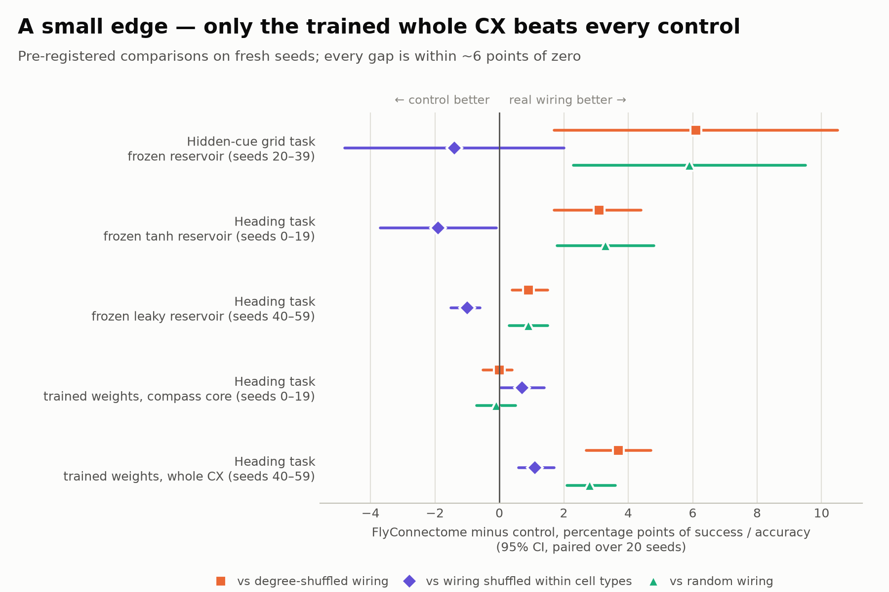
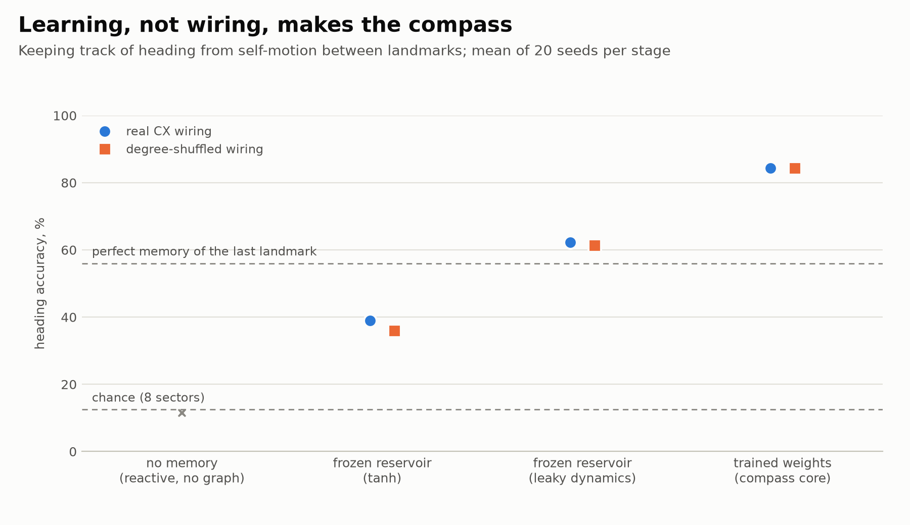

# NeuroFlyNav

[](https://github.com/kat1478/NeuroFlyNav/actions/workflows/quality.yml)


**Does the wiring of a fly's navigation centre make a better brain for an artificial agent?**

NeuroFlyNav takes the real connectome of the *Drosophila* central complex (CX) — the brain
region flies use to keep track of heading and steer — and uses it as the fixed recurrent core
of a navigation agent. It then compares that agent against fair controls: the same wiring
shuffled, a random network of the same size, and a network with no memory at all. Biological
topology is a hypothesis to test, not an assumption; a negative result is a valid outcome.

> **Status: v0.5.0, exploratory.** The pipeline runs end to end on the real CX wiring (2,966
> neurons, 467,579 connections), locally or as containerised sweeps on AWS Batch. Dynamics,
> inputs and readout are placeholders, and no experiment has been frozen yet. Numbers below
> are first looks (most of them pre-registered), not a scientific claim.

<picture>
  <source media="(prefers-color-scheme: dark)" srcset="docs/figures/cx-wiring-dark.png">
  
</picture>

## How it works

```
hemibrain v1.2 connectome ──► CX subgraph ──► frozen recurrent "reservoir" ──► linear readout ──► action
 (public export, CC BY)       6 CX regions     W scaled to spectral radius 1.1    trained by
                              weight ≥ 1        state = tanh(W·state + input)      imitation (ridge)
```

1. **Graph** — every neuron with at least one synapse in the six CX regions (AB, EB, FB, NO,
   PB), and every directed connection between them (`neuroflynav.graph.hemibrain`).
2. **Reservoir** — the wiring becomes a fixed weight matrix; observations enter at the ring
   neurons (`ER*`), the state evolves through the real connections (`neuroflynav.agent.reservoir`).
3. **Task** — a grid world where the goal direction is shown only for the first few steps, so
   the agent must *remember* it (`neuroflynav.env.nav_memory`).
4. **Training** — only the readout is learned, by imitating an expert (`neuroflynav.training`).
5. **Controls** — `ShuffledFly` (degree-preserving rewiring), `TypeShuffledFly` (rewiring within
   cell types), `RandomRecurrent` (matched edge count), `Reactive` (no memory).

## Results at a glance

<picture>
  <source media="(prefers-color-scheme: dark)" srcset="docs/figures/results-forest-dark.png">
  
</picture>

<picture>
  <source media="(prefers-color-scheme: dark)" srcset="docs/figures/heading-progression-dark.png">
  
</picture>

<picture>
  <source media="(prefers-color-scheme: dark)" srcset="docs/figures/learning-curve-dark.png">
  
</picture>

Numbers behind every chart: the tables in `docs/spike_*.md`. Rebuild the figures with
`PYTHONPATH=src python -m neuroflynav.reporting.figures`.

## First look (20 seeds)

Success rate on the hidden-cue task, mean and 95% CI, `log1p` edge weights:

| Agent | Success rate |
| --- | --- |
| FlyConnectome (real CX wiring) | 0.64 [0.59, 0.68] |
| ShuffledFly (same degrees, rewired) | 0.56 [0.53, 0.60] |
| RandomRecurrent (same size) | 0.57 [0.53, 0.61] |
| Reactive (no memory) | 0.31 [0.30, 0.32] |

Paired difference FlyConnectome − ShuffledFly: **+0.08 [+0.02, +0.13]** — a small edge for the
real wiring. A pre-registered follow-up on fresh seeds 20–39 **replicated** it (+0.06
[+0.02, +0.11]) and showed where it comes from: a control that keeps the cell-type-to-cell-type
wiring but shuffles exact partners performs as well as the real graph (−0.01 [−0.05, +0.02]).
On this task the benefit is in *which cell types connect*, not in the exact neuron map. With
wiring-only (`binary`) weights there is no edge. All of this is exploratory: toy task,
placeholder dynamics. Full tables: [docs/spike_m1.md](docs/spike_m1.md).

A second, pre-registered task — keeping track of heading from self-motion between landmarks —
gives the same picture: real wiring +0.03 over the degree-preserving shuffle, cell-type
structure enough, and no reservoir yet integrates (all stay below a memory-only reference).
Adding biologically placed inhibition (Δ7 and ring neurons) to the generic reservoir made it
*worse* — a sign that the dynamics, not the wiring or the signs, are now the bottleneck.
With *leaky* (slower) dynamics the reservoir finally integrates self-motion, beating a perfect
memory of the last landmark by +0.07 — but so does every control, and the real wiring keeps only a
~1-point edge. Integration comes from the dynamics; cell-type structure explains the rest.
See [docs/spike_heading.md](docs/spike_heading.md).

Training the recurrent weights on the compass-core mask (409 neurons) makes a much better
integrator (0.84 vs 0.52 frozen) — but a random mask of the same density trains just as well,
and with scarce data even slightly better (−2.4 points for the real mask, pre-registered).
The compass core is dense (26% of all possible connections). On the **whole CX** (5.3%), run as
100 cloud jobs, the picture changes: the real wiring trains better than a random mask of the
same size (**+2.8 points [+2.1, +3.6]**, the pre-registered test) and than a degree-preserving
shuffle (+3.7). Shuffling within cell types costs only +1.1, so cell-type structure
carries most of the advantage. One task, one model, one training budget — a lead, not a
conclusion. See [docs/spike_trained.md](docs/spike_trained.md).

## Cloud runs

The whole-CX sweep (5 variants × 20 seeds) would take ~30 h on a laptop. It runs on AWS as a
Batch array job, one container per (variant, seed):

```
git commit ──► Docker image ──► Amazon ECR ──► AWS Batch array job ──► S3 results ──► aggregate
 (code)        micromamba,       private       Fargate Spot, 4 vCPU       one JSON     same summary
               same conda env    registry      / 8 GB per job, ≤3 at once  per job      as local runs
```

- **Infrastructure as code** — Terraform in [infra/](infra/README.md): ECR, a private encrypted
  S3 bucket, least-privilege IAM roles (jobs can only write results), Batch on Fargate Spot,
  CloudWatch logs and a cost budget with alerts.
- **Reproducible** — the image is tagged with the git commit; the container downloads the
  public connectome and checks its SHA-256; a pilot job matched the local result exactly.
- **Measured** — 100/100 jobs succeeded, 7.8 job-hours in 3.3 h wall time, an estimated <1 USD
  (Fargate Spot list price; billing data pending);
  idle cost is near zero because Fargate scales to zero.

How to run it: [docs/cloud.md](docs/cloud.md).

## Quick start

```bash
mamba env create -f environment.yml
conda activate neuroflynav
make quality                                   # pytest, ruff format/lint, mypy

# synthetic graph, no download needed
PYTHONPATH=src python -m neuroflynav.experiments.run_m0plus --seed 0

# real CX wiring: download the public export first (46 MB, see docs/spike_m1.md)
PYTHONPATH=src python -m neuroflynav.experiments.run_m0plus --graph hemibrain --weights log1p
PYTHONPATH=src python -m neuroflynav.experiments.run_m1_seeds --seeds 20
```

Dependencies are managed with Conda only (`environment.yml`, conda-forge). The `src/` layout is
importable without installation; one hemibrain seed takes about 30 s on a laptop CPU.

## Documentation

| Doc | What it covers |
| --- | --- |
| [docs/spike.md](docs/spike.md) | M0: first end-to-end loop on a synthetic graph |
| [docs/spike_m0plus.md](docs/spike_m0plus.md) | M0+: hidden-cue task and reservoir, so topologies can be told apart |
| [docs/spike_m1.md](docs/spike_m1.md) | M1: real hemibrain CX wiring, data download, multi-seed results |
| [docs/spike_heading.md](docs/spike_heading.md) | Heading integration task: landmarks + self-motion, pre-registered result |
| [docs/spike_trained.md](docs/spike_trained.md) | Recurrent weights trained on the CX mask (compass core and whole CX), pre-registered results |
| [docs/cloud.md](docs/cloud.md) | Container and AWS Batch sweeps: build, push, submit, collect |
| [infra/README.md](infra/README.md) | Terraform stack for the cloud runs |
| [docs/reproducibility.md](docs/reproducibility.md) | Provenance capture for runs |
| [CHANGELOG.md](CHANGELOG.md) | Release history |

## Roadmap

- **M2 — honest science:** a harder task where fine wiring could matter, signed synapses, a
  frozen protocol and a one-shot holdout.
- **M3 — cloud (done in v0.5.0):** containerised multi-seed sweeps on AWS Batch (CPU) with S3
  artifacts and Terraform; next: dispatch from GitHub Actions via OIDC.
- **M4 — write-up:** results notebook, figures, short report.

## Data and citation

Connectome data: hemibrain v1.2, Janelia FlyEM, CC BY 4.0 — Scheffer et al. (2020), *eLife*
9:e57443, https://doi.org/10.7554/eLife.57443. Central-complex context: Hulse et al. (2021),
*eLife* 10:e66039. The data is downloaded locally and never committed.

## License

Code: [MIT](LICENSE) © 2026 Katarzyna Kadyszewska. Connectome data keeps its own license (CC BY 4.0).
